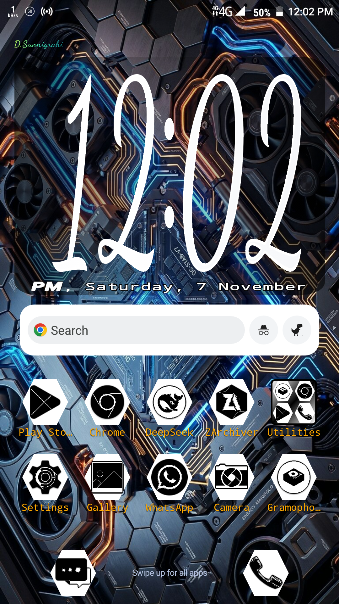
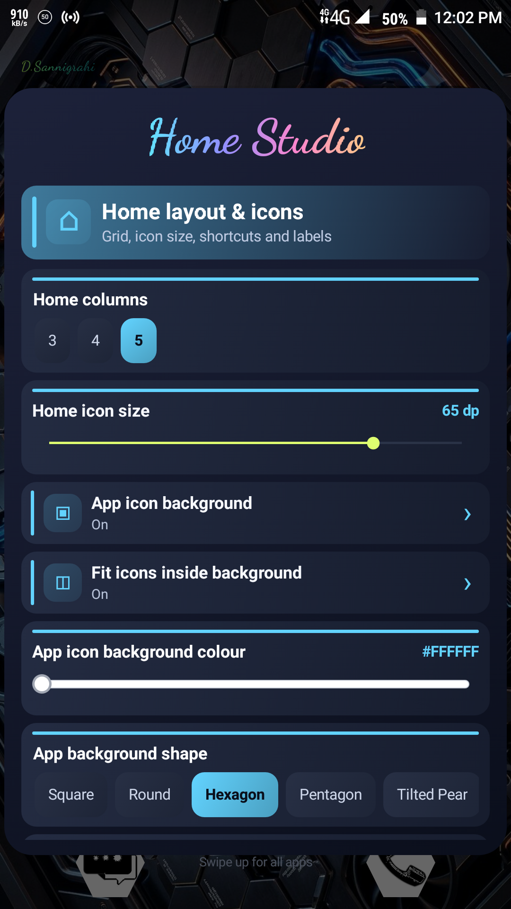
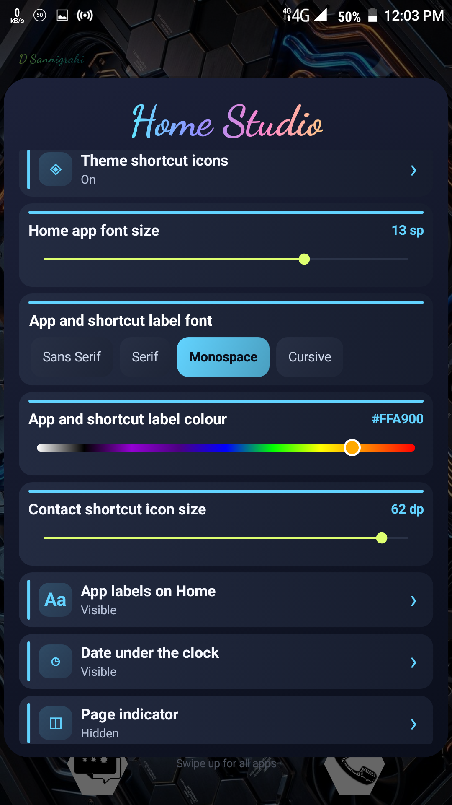
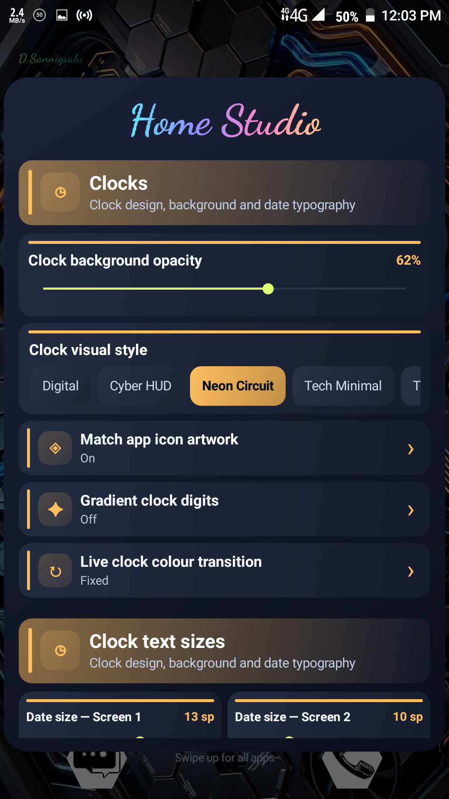
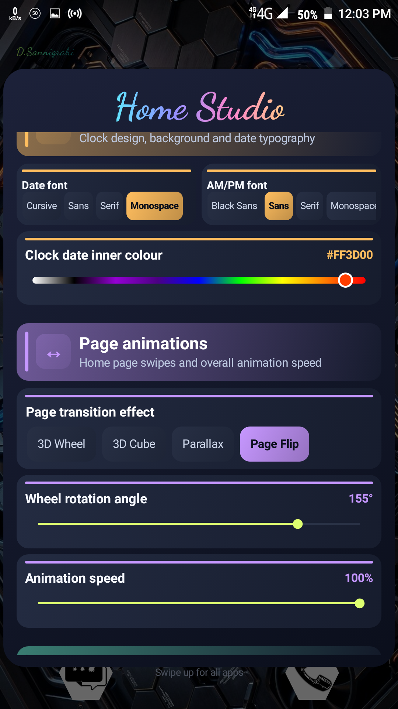
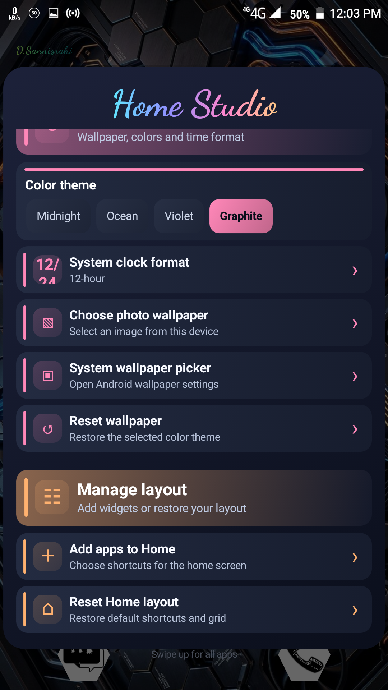
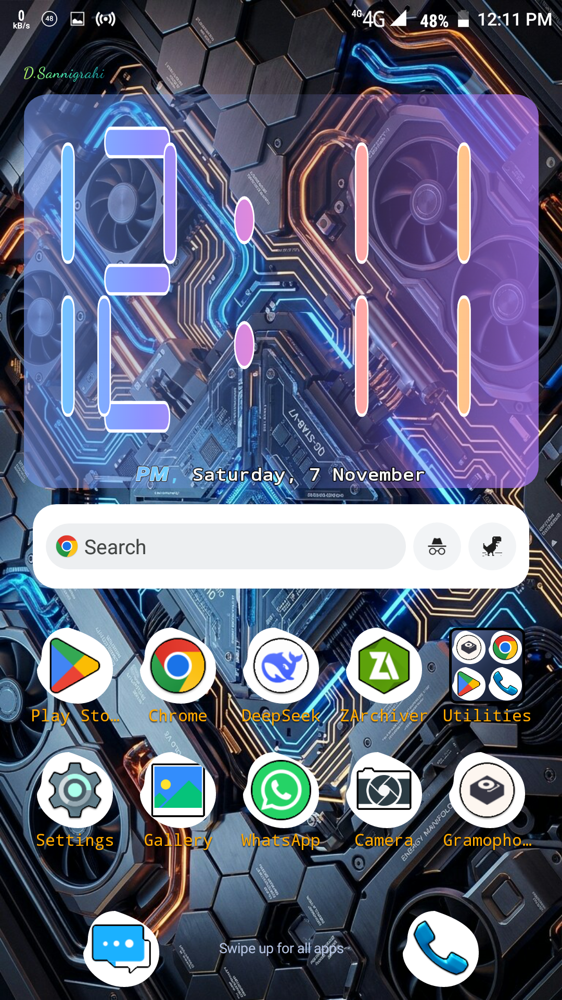

<div align="center">

  

  <h1>Quantum Launcher</h1>
  <h3>Your home screen. Your space. Your rules.</h3>

  <p>
    A customizable Android launcher with a focused two-page workspace,
    expressive visual themes, distinctive clocks, and motion you can make your own.
  </p>

  <p>
    <a href="https://github.com/DS-ann/Quantum-Launcher/actions/workflows/Build.yml">
      
    </a>
    
    
    
    
  </p>

  <p>
    <a href="#screenshots">Screenshots</a> ·
    <a href="#make-it-yours">Features</a> ·
    <a href="#getting-started">Get started</a> ·
    <a href="#build-and-release">Build & release</a>
  </p>

</div>

---

## A different kind of home screen

Quantum Launcher is an Android home-screen replacement built around a simple idea: your home screen should feel like *your* space.

Keep your everyday apps close on a deliberately focused **two-page workspace**. Shape the experience with Home Studio, create app groups, add Android widgets, style your icons, and choose how the interface moves. From a minimal dark setup to a vivid gradient design, the launcher gives you room to build an environment that suits your workflow.

## Screenshots

The gallery below uses the original captures stored in [Screenshots/](Screenshots/).

<table>
  <tr>
    <td align="center" width="33%">
      
      <br /><sub>01</sub>
    </td>
    <td align="center" width="33%">
      
      <br /><sub>02</sub>
    </td>
    <td align="center" width="33%">
      
      <br /><sub>03</sub>
    </td>
  </tr>
  <tr>
    <td align="center">
      
      <br /><sub>04</sub>
    </td>
    <td align="center">
      
      <br /><sub>05</sub>
    </td>
    <td align="center">
      
      <br /><sub>06</sub>
    </td>
  </tr>
  <tr>
    <td align="center" colspan="3">
      
      <br /><sub>08</sub>
    </td>
  </tr>
</table>

## Make it yours

### A focused two-page workspace

Keep your most-used apps and widgets organized without an endless stack of home pages.

- Two home pages with independent item placement.
- Horizontal page navigation and a configurable dock.
- Drag-and-drop app organization and page-edge transfers.
- Adjustable grid columns, icon size, labels, and page indicator.
- Home-screen groups for keeping related apps together.

### Home Studio

Home Studio is the launcher's central customization space. Open it by holding an empty area on the first home page.

| Customization area | Available controls |
|:--|:--|
| Home layout | Grid columns, icon size, labels, label typography, dock, and page indicator |
| Icon appearance | Icon background, color, fit, shape, and artwork theme |
| Clock | Clock style, background opacity, date, AM/PM, typography, and gradients |
| Home-page motion | Transition style, wheel angle, and animation speed |
| App drawer | Columns, icon size, labels, sorting, spacing, opacity, and opening effect |
| Appearance | Midnight, Ocean, Violet, Graphite, and wallpaper choices |
| Launcher identity | Custom home-brand label |

### Icon styles with personality

Choose a shape and tune the way app artwork sits inside it.

**Background shapes**
- Square
- Round
- Hexagon
- Pentagon
- Tilted Pear

**Artwork themes**
- Original Colours
- Spectrum Mix
- Ocean Gradient
- Sunset Gradient
- Nothing Monochrome

You can enable or disable icon backgrounds, adjust their color, and change artwork fit and sizing.

### Six clock styles

Make the clock a central part of the home screen or keep it understated.

1. Digital
2. Cyber HUD
3. Neon Circuit
4. Tech Minimal
5. Terminal Digital
6. 7-Segment Digital

Customize the clock background, date display, date and AM/PM typography, artwork matching, gradient digits, and live gradient transitions. Date and AM/PM sizing can be adjusted separately for each home page.

### An app drawer with its own identity

The drawer has independent layout and presentation settings:

- Adjustable columns, icon size, and label size.
- Optional app labels.
- Alphabetical sorting from A to Z or Z to A.
- Compact or comfortable spacing.
- Configurable background opacity.
- Independent opening animations: Parallax, 3D Card Flip, Depth Slide, and Rotating Carousel.

### Groups, widgets, and shortcuts

- Create rounded app groups on the home screen.
- Add, remove, rename, and delete group members and groups.
- Add Android-provided widgets through the widget picker.
- Move and resize supported workspace widgets.
- Add contact and direct-call shortcuts.

Widget availability depends on the provider app, Android version, and device manufacturer.

### Four built-in themes

| Theme | Visual direction |
|:--|:--|
| **Midnight** | Deep, restrained dark surfaces |
| **Ocean** | Cool blue and deep teal |
| **Violet** | Purple-toned depth |
| **Graphite** | Neutral, low-key contrast |

Pair a theme with a device photo or Android's system wallpaper picker. Wallpapers and customization choices can change the final appearance.

## Motion that feels intentional

Choose the transition that gives your workspace the right character:

| Home-page transition | App-drawer transition |
|:--|:--|
| 3D Wheel | Parallax |
| 3D Cube | 3D Card Flip |
| Parallax | Depth Slide |
| Page Flip | Rotating Carousel |

Motion speed and wheel rotation can also be adjusted in Home Studio.

## Getting started

### Install Quantum Launcher

1. Open [GitHub Releases](https://github.com/DS-ann/Quantum-Launcher/releases) and download the APK from a published release.
2. Install the APK on your Android device.
3. Press the device's **Home** button.
4. Select **Quantum Launcher** when Android asks which home app to use.
5. Choose the default option to make it your home screen.

If Android does not show a chooser, open **Settings → Apps → Default apps → Home app**. The exact menu name varies by manufacturer.

### Essential navigation

| Gesture / action | Result |
|:--|:--|
| Hold an empty area on Home page 1 for about 2 seconds | Open Home Studio |
| Swipe left or right | Switch between the two home pages |
| Swipe up on Home | Open the app drawer |
| Swipe down on Home | Open Control Centre / Android Quick Settings |
| Hold and drag an app icon | Move the app |
| Hold a supported item | Open its available actions |

**Quick Settings:** the downward launcher gesture uses the launcher's accessibility service. Enable Quantum Launcher in Android Accessibility settings when prompted. The service description states that it does not read or collect screen content.

## Compatibility

Quantum Launcher is configured for **Android 6.0 (API 23) and newer**.

| Build setting | Value |
|:--|:--|
| Application ID | `com.dsann.launcher` |
| Current version | `18.7.0` |
| Version code | `180700` |
| Minimum SDK | `23` · Android 6.0 |
| Target SDK | `37` |
| Compile SDK | `37` |
| Java source / target | Java 8 |
| UI foundation | Native Android views |

Android's widget framework, wallpaper picker, accessibility settings, and default-home selection can differ across OS versions and manufacturers. SDK compatibility does not replace testing on physical devices.

## Build and release

### Build locally

**Requirements**
- JDK 17
- Android SDK Platform 37
- Android Build Tools 37.0.0
- Gradle 9.3.1

From the repository root:

```bash
gradle assembleDebug
```

To build the release variant:

```bash
gradle assembleRelease
```

The release variant is signed only when the signing keystore environment is configured.

### GitHub Actions workflows

Both workflows are **manual-triggered only** and are intended to run from the `main` branch.

| Workflow | What it does |
|:--|:--|
| [Build Quantum Launcher APK](https://github.com/DS-ann/Quantum-Launcher/actions/workflows/Build.yml) | Builds and signs the APK, verifies its signature, and uploads the APK as a workflow artifact. Artifacts are retained for 14 days. |
| [Publish Quantum Launcher Release](https://github.com/DS-ann/Quantum-Launcher/actions/workflows/Release.yml) | Builds and signs the APK, verifies it, creates a GitHub Release, and attaches the APK as a downloadable release asset. Supports a pre-release option. |

**To publish a release**

1. Open [Actions → Publish Quantum Launcher Release](https://github.com/DS-ann/Quantum-Launcher/actions/workflows/Release.yml).
2. Select **Run workflow** on the `main` branch.
3. Choose whether the release should be marked as a pre-release.
4. Start the workflow and check the run result.
5. Open [Releases](https://github.com/DS-ann/Quantum-Launcher/releases) to find the published APK and release notes.

The release workflow reads `versionName` and `versionCode` from `app/build.gradle`. It creates a tag in the form `v<versionName>`. Increase the app version before publishing another release; an existing release tag cannot be reused as a new version.

### Release signing

The Actions workflows use the repository's configured signing secrets to prepare and validate the PKCS#12 keystore. Keep keystores, passwords, and private signing material in GitHub Actions Secrets. Never commit them or a generated signed APK to the repository.

## Project structure

```text
.
├── .github/
│   └── workflows/
│       ├── Build.yml
│       └── Release.yml
├── Screenshots/
│   ├── 1.png
│   ├── 2.png
│   ├── 3.png
│   ├── 4.png
│   ├── 5.png
│   ├── 6.png
│   └── 8.png
├── app/
│   ├── build.gradle
│   └── src/main/
│       ├── AndroidManifest.xml
│       ├── java/com/dsann/launcher/
│       │   ├── MainActivity.java
│       │   ├── BlankActivity.java
│       │   ├── HomePageController.java
│       │   ├── HomePageModel.java
│       │   ├── LauncherAppAdapter.java
│       │   ├── LauncherDrawerController.java
│       │   ├── LauncherScreenTransitions.java
│       │   ├── LauncherIconDrawable.java
│       │   ├── WidgetController.java
│       │   ├── WidgetInteractionController.java
│       │   └── LauncherUiUtils.java
│       └── res/
├── build.gradle
├── gradle.properties
└── settings.gradle
```

### Core components

| Component | Responsibility |
|:--|:--|
| `MainActivity` | Main launcher, navigation, Home Studio, clock, drawer, gestures, and workspace |
| `HomePageModel` | Two-page workspace model and saved page membership |
| `HomePageController` | Home-page rendering, layout, and item positioning |
| `LauncherAppAdapter` | App-cell rendering, labels, and icons |
| `LauncherDrawerController` | Drawer behavior and presentation |
| `LauncherScreenTransitions` | Home and drawer transition effects |
| `LauncherIconDrawable` | Icon shape and artwork rendering |
| `WidgetInteractionController` | Widget movement, resizing, and workspace interaction |
| `BlankActivity` | Launcher identity page opened from the app-drawer entry |

The project uses Java and Android's native view system. The design aims to keep the UI foundation close to the platform and avoid unnecessary third-party UI dependencies.

## Testing and known limits

A successful CI build confirms that the APK builds and its signature verifies. It does **not** prove that every interaction works correctly on every Android device.

When testing a build, pay particular attention to:

- Home and drawer gestures, including quick repeated swipes.
- App movement, page-edge transfers, and layout after orientation changes.
- Widget add, resize, restore, and provider-specific behavior.
- Clock sizing and text placement on both home pages.
- Wallpaper selection and default-home behavior.
- Accessibility-mediated Quick Settings access.

When reporting an issue, include the Android version, device model, reproduction steps, and a log or screenshot when available.

## Contributing

- Preserve the Android 6.0 minimum unless a compatibility change is intentional.
- Keep the Java / native-view architecture in mind.
- Avoid heavyweight dependencies for effects that can be implemented with platform APIs.
- Preserve saved workspace positions when changing grid, icon, widget, or orientation behavior.
- Test both home pages and the drawer after gesture or layout changes.
- Distinguish CI success from behavior verified on a physical device.

## License

No license is currently included in this repository. Until one is added, do not assume the source is available for unrestricted reuse, redistribution, or modification.

---

<div align="center">

  **Quantum Launcher**  
  <sub>Created by Debarghya Sannigrahi · Make the space you come home to feel like yours.</sub>

</div>
